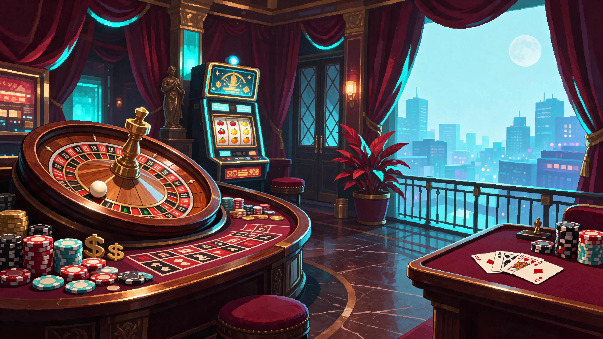

# Cassino Pixel



> Blackjack, pôquer e caça-níquel em um cassino pixel-art com fichas virtuais e partidas rápidas.

## Jogar

**[Abrir Cassino Pixel no navegador](https://gabrielaraujo-eng.github.io/cassino-pixel/)**

A versão publicada fica na raiz deste repositório e é disponibilizada pelo GitHub Pages.

## Versão atual

A versão atual identificada no catálogo é **atual**. As versões históricas permanecem separadas em [`versoes-antigas/`](./versoes-antigas/) quando disponíveis, sem substituir o jogo atual.

## Sobre o jogo

Blackjack, pôquer e caça-níquel em um cassino pixel-art com fichas virtuais e partidas rápidas. O projeto foi separado do Arcade Gabriel para manter uma cópia independente, fácil de jogar, consultar e preservar.

## Controles e como jogar

- Abra o link acima e use as instruções exibidas na tela inicial.
- O jogo funciona diretamente no navegador, sem instalação.
- Em telas menores, use os controles touch quando o jogo oferecer essa opção.

## Rodar localmente

Sirva esta pasta por HTTP para que scripts, módulos e recursos carreguem corretamente:

```bash
python3 -m http.server 8000
```

Depois abra <http://localhost:8000>.

## SEO e identidade visual

A página inclui título e descrição específicos, URL canônica, Open Graph, Twitter Card, `robots.txt`, sitemap, favicon e banner próprios deste jogo.

## Privacidade

Este repositório não inclui o bloco de coleta de atividade, ranking ou envio de estatísticas para serviços externos. O progresso local que o jogo eventualmente oferecer permanece no navegador.

## Histórico

As versões antigas estão em pastas próprias dentro de [`versoes-antigas/`](./versoes-antigas/), preservadas para comparação e memória do desenvolvimento.

## Créditos

Criado por **Gabriel Lúcio de Araújo**.
